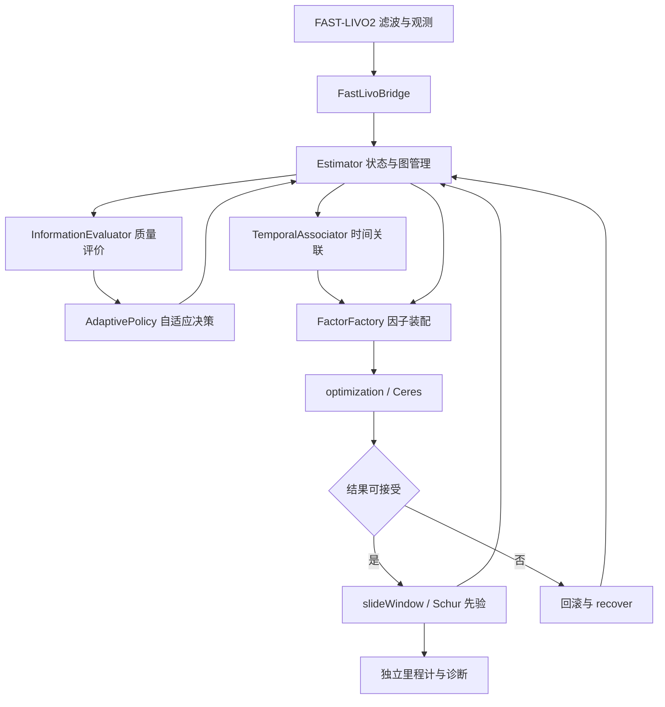

# adaptive_window 中文代码框架与阅读指南

本文对应 `feature/ceres-sliding-window` 分支，注释整理基于提交
`db25302f507e6454cf163a75542abbbd04ced6e0`。本次只补充中文注释和说明文件，
不修改算法、参数默认值、函数签名或求解流程。

后端在 FAST-LIVO2 滤波状态附近进行滑窗联合优化：新节点由滤波结果初始化，
通过逐帧位姿正则限制偏离程度，再利用 LiDAR、视觉、IMU 和跨模态残差精化。
当前是研究实现，C++ 编译、测试执行和数据集回放尚未完成。
详细公式与构建方法见[集成指南](ADAPTIVE_WINDOW_INTEGRATION.md)，
验证范围见[验证记录](CERES_BACKEND_VALIDATION.md)。

## 1. 总体结构与模块边界

桥接层负责 ROS 与前端数据类型，核心负责状态、因子和优化；核心不直接访问体素地图。
代码在前端处理线程内同步执行，独立发布后端结果，不向前端回写状态、协方差、地图或外参。
这里的独立输出不表示独立工作线程。原 FAST-LIVO2 前端初始化、去畸变和地图管理继续使用。

### 文件职责对照

下表覆盖 `include/adaptive_window` 和 `src/adaptive_window` 的全部 28 个头文件/实现文件。
多数因子在头文件中定义模板，因而没有单独的 `.cpp`。

| 模块与代码入口 | 主要职责 |
|---|---|
| [types.h](../include/adaptive_window/types.h) | 导航状态、外参、观测摘要、策略输入、配置和诊断；字段注释说明单位与坐标系 |
| [ceres_types.h](../include/adaptive_window/ceres_types.h) | 参数块类型、稳定键、存储/切空间维数、四元数与参数打包工具 |
| [math_utils.h](../include/adaptive_window/math_utils.h) | 四元数、限幅和旧布局数学辅助；其中旧增量布局不能直接代入 Ceres |
| [estimator.h](../include/adaptive_window/estimator.h) / [estimator.cpp](../src/adaptive_window/estimator.cpp) | 状态与内存所有者；接纳输入、建立因子、求解、滑窗和恢复 |
| [adaptive_window_backend.h](../include/adaptive_window/adaptive_window_backend.h) | 兼容旧桥接接口的薄适配器，转发给 Estimator |
| [fast_livo_bridge.h](../include/adaptive_window/fast_livo_bridge.h) / [fast_livo_bridge.cpp](../src/adaptive_window/fast_livo_bridge.cpp) | ROS 参数、前端状态/观测转换、投影与图像回调、输出发布 |
| [information_evaluator.h](../include/adaptive_window/information_evaluator.h) / [information_evaluator.cpp](../src/adaptive_window/information_evaluator.cpp) | 信息矩阵特征值、log-det、残差质量、可靠性和平滑历史 |
| [adaptive_policy.h](../include/adaptive_window/adaptive_policy.h) / [adaptive_policy.cpp](../src/adaptive_window/adaptive_policy.cpp) | 模态权重、窗口目标、关键帧接纳和边缘化候选 |
| [temporal_associator.h](../include/adaptive_window/temporal_associator.h) / [temporal_associator.cpp](../src/adaptive_window/temporal_associator.cpp) | 保留 LiDAR 帧的最近邻时间关联、时间置信度和复用标记 |
| [measurement_types.h](../include/adaptive_window/factor/measurement_types.h) | 核心使用的点面/patch/局部平面观测，以及相机投影和图像采样回调 |
| [factor_factory.h](../include/adaptive_window/factor/factor_factory.h) / [factor_factory.cpp](../src/adaptive_window/factor/factor_factory.cpp) | 构造残差、绑定参数键、检查初始可求值性、拟合扫描局部平面 |
| [pose_local_parameterization.h](../include/adaptive_window/factor/pose_local_parameterization.h) | Ceres Manifold 的 Plus/Minus 与真实 Jacobian |
| [integration_base.h](../include/adaptive_window/factor/integration_base.h) / [integration_base.cpp](../src/adaptive_window/factor/integration_base.cpp) | IMU 时间裁剪、中值预积分、Jacobian/协方差、偏置重积分及白化 |
| [imu_factor.h](../include/adaptive_window/factor/imu_factor.h) | 15 维 IMU 预积分残差 |
| [lidar_factor.h](../include/adaptive_window/factor/lidar_factor.h) | LiDAR 点到地图平面的残差 |
| [photometric_factor.h](../include/adaptive_window/factor/photometric_factor.h) | 参考 patch 重投影、当前图像采样与光度残差 |
| [patch_plane_factor.h](../include/adaptive_window/factor/patch_plane_factor.h) | patch 中心逆深度与 LiDAR 局部平面的几何残差 |
| [frontend_pose_factor.h](../include/adaptive_window/factor/frontend_pose_factor.h) | 每个保留状态相对 FAST-LIVO2 位姿快照的正则 |
| [initial_state_factor.h](../include/adaptive_window/factor/initial_state_factor.h) | 首次状态先验与外参先验 |
| [marginalization_factor.h](../include/adaptive_window/factor/marginalization_factor.h) / [marginalization_factor.cpp](../src/adaptive_window/factor/marginalization_factor.cpp) | 残差块描述、切空间线性化、Schur 消元与平方根先验 |

## 2. 从前端输入到一次滑窗求解

前端入口在 [LIVMapper.cpp](../src/LIVMapper.cpp)：
`handleLIO()` 完成激光滤波后调用 `FastLivoBridge::ProcessLidar()`；
`handleVIO()` 完成视觉滤波后调用 `ProcessVision()`。
`backendImuMeasurements()` 额外只读获取帧末之后的首个 IMU 样本，供端点插值，
不弹出前端队列中的该样本。

| 顺序 | 函数 | 实际工作与关键分支 |
|---|---|---|
| 1 | `ProcessLidar / ProcessVision` | 保存滤波状态，转换原始观测与质量摘要；加速度按前端尺度转换为 m/s² |
| 2 | `processIMU` | 将实际时间戳样本排序、去重并缓存；允许相邻数据包重叠 |
| 3 | `processLidar / processImage → decide` | 拒绝重复/过旧事件；评价当前模态，屏蔽过期模态摘要，更新策略 |
| 4 | `addOrGetFrame` | 容差内同时间复用节点；新时间需通过关键帧判定和 IMU 区间检查 |
| 5 | `FactorFactory` | 建立点面、光度、patch–平面因子；新节点同时建立惯性连接和所需先验 |
| 6 | `solveOdometry → optimization` | 打包状态、必要时重积分、构建 Ceres 问题、求解并检查结果 |
| 7 | `failureDetection → double2vector` | 接受时写回核心状态；不可用或修正超限时原位恢复参数 |
| 8 | `slideWindow` | 超过目标就选择非最新帧，完成边缘化并清理已吸收信息 |
| 9 | `Publish` | 发布最新保留状态、外参消息和诊断；时间戳取估计状态自身的时刻 |

`solveOdometry()` 在优化失败或边缘化失败后调用 `recover()`：
清空后端图、保留 IMU 缓冲和累计异常计数，等待后续输入重建。
直接调用低层 `optimization()` 只负责求解与参数回滚，不自动清空整图。
传感器入口返回 false 也可能只是未选关键帧或 IMU 不足，应结合诊断判断。

## 3. VINS 风格变量、状态与内存

### 3.1 状态容器

| 名称 | 内容与约束 |
|---|---|
| `Rs, Ps, Vs, Bas, Bgs` | 按稳定帧 ID 保存姿态、位置、速度、加速度偏置、陀螺仪偏置 |
| `Headers` | 按稳定 ID 保存 double 秒时间戳 |
| `nodes_` | 帧元数据、重力、模态标记和策略统计；最新优化位姿从 Rs/Ps 等组装 |
| `frontend_poses_` | 独立的滤波参考快照，仅由前端新事件更新，不跟随后端解移动 |
| `parameter_blocks_` | 唯一拥有 Ceres 参数数组内存的容器 |
| `para_Pose / para_SpeedBias / para_Feature / para_Ex_Pose` | 指向上述数组的视图；不能自行释放或随意重分配 |
| `pre_integrations` | 以边的终点 ID 为键，持有仍存活的 IMU 预积分 |
| `tmp_pre_integration` | 新 IMU 边成功入图之前的临时对象 |
| `last_marginalization_info` | 当前先验的线性化基点和平方根系统 |
| `last_marginalization_parameter_blocks` | 按先验参数键顺序保存的保留变量地址 |

稳定 ID 在一次图生命周期内递增，删除后不连续；不能用作 VINS 连续数组下标。
`frame_count` 是当前节点数量，不是最新节点的槽位索引。
`vector2double()` 原位填充已有数组；`double2vector()` 只接收通过检查的求解结果。
禁止复制 Estimator，避免复制后的参数视图仍指向原实例内存。

### 3.2 坐标系与参数排列

约定 `T_AB` 将 B 系坐标变换到 A 系，W/I/C/L 分别表示世界、IMU、相机、LiDAR。

| 对象 | 存储或方向 | 使用注意 |
|---|---|---|
| 导航位姿 | `T_WI`，`[p_x,p_y,p_z,q_x,q_y,q_z,q_w]` | 7 维存储，6 维切空间 |
| 位姿增量 | `[dp_world, dtheta_body]` | 位置加法、四元数右乘旋转增量 |
| 速度与偏置 | `[v_W, ba, bg]`，9 维 | 速度在世界系；偏置对应 IMU 测量模型 |
| LiDAR 外参 | 固定 `T_IL` | LiDAR 到 IMU |
| 相机外参 | 可优化 `T_CI`，7/6 维 | IMU 到相机；与 VINS 常用 T_IC 方向相反 |
| patch 深度 | `rho=1/z`，1 维 | 参考相机中心射线的逆 z 深度，不是欧氏距离的倒数 |
| IMU 误差 | `[dp,dtheta,dv,dba,dbg]`，15 维 | 协方差、偏置 Jacobian、残差必须采用同一排列 |
| 前端信息摘要 | `[rotation,position]`，6×6 | 用于策略打分，不直接作为 Ceres 位姿局部 Hessian |
| 旧数学辅助增量 | NavState 为 `[dtheta,dp,dv,dbg,dba]`；外参为 `[dtheta,dp]` | `math_utils.h` 保留的旧接口；当前 Ceres 更新不使用该排列 |

`PoseLocalParameterization` 虽沿用 VINS 命名，实际使用 Ceres 2.1+ Manifold API。
它提供真实的 7×6 Plus Jacobian；不能替换成旧代码中用于特定链式约定的占位矩阵。
`math_utils.h` 的旧平方根信息辅助也不是当前 Schur 零空间处理的替代品。

## 4. 因子结构与观测生命周期

| 因子 | 残差维数 / 参数块 | 观测含义与实现边界 |
|---|---|---|
| LiDAR 点面 | 1 / 当前 pose | 去畸变 LiDAR 点经 T_IL、T_WI 变换后到固定地图平面的距离；迭代时重新计算几何，不重新匹配地图 |
| 视觉光度 | M，桥接层 M=16 / 参考 pose、当前 pose、T_CI、rho | 参考射线与固定切平面相交，再投影到当前图像；比较曝光修正灰度，按 sigma·sqrt(M) 白化 |
| IMU | 15 / 两端 pose 和 speed-bias | 中值预积分、一阶偏置修正、完整协方差白化；旋转项使用四元数误差的 2·vec |
| patch–平面 | 1 / 参考 pose、LiDAR pose、T_CI、rho | patch 中心点到扫描局部平面的距离；两个 pose 相同时抵消，只保留 T_CI 与 rho |
| 前端位姿 | 6 / 单个 pose | 平移差和 Log 旋转差，按可调尺度归一化，无 Huber |
| 首次状态 / 外参先验 | 15 / pose 与 speed-bias；6 / T_CI | 启用逐帧位姿正则时首次状态的前 6 项为零，仍保留速度与偏置约束 |
| 边缘化先验 | 保留变量局部总维数 / 对应参数块 | 固定线性化基点上的平方根残差；数值零空间对应行可为零 |

传感器因子按各自噪声白化，LiDAR、光度、跨模态因子使用 Huber 和模态权重；
IMU 不使用这些自适应模态权重。前端位姿项使用独立正则权重，
复用了同一批传感器信息，因此不解释为独立测量，也不等同于滤波协方差。

### 4.1 patch 如何建立、复用和删除

1. 桥接层从原始灰度图导出 4×4 稀疏样本、射线、法向、曝光和稳定 track ID。
2. 新 track 需在最近的保留 LiDAR 帧中找到有效局部平面，再创建参考 patch 和逆深度。
   平面支持点来自该扫描的前端点面内点；检查邻域点数、PCA 特征值、RMS 和关联距离。
3. 首次 patch 建立一个几何因子。后续同一 track 在不同保留节点出现时，
   才增加参考节点到当前节点的光度因子；不重复加入同一个几何深度观测。
4. 图像回调持有 clone 后的图像，避免前端覆写像素。每次求值重新投影和双线性采样，
   采样梯度是该插值的分片导数；相机投影 Jacobian 使用中心差分，变换部分衔接自动微分。
5. 参考节点被边缘化时，其逆深度和全部相连光度信息一起消元。
   以后再次看到该 track 可以建立新参考，旧图像在无活跃因子引用后释放。

曝光、地图平面和参考 patch 法向目前固定；没有后端曝光优化、多尺度金字塔、
完整 patch 法向对齐、在线重关联或显式遮挡检测。

### 4.2 IMU 的区间与偏置

`IntegrationBase::integrate()` 先把原始 IMU 裁剪到两个状态的实际时间区间。
两端必须由样本包围，端点线性插值；缺端点或内部间隔超过 `imu_max_gap` 时拒绝，
不靠最新样本填补整段数据。首个节点后，新节点需要有效的惯性连接。

`midPointIntegration()` 传播 `delta_p/delta_q/delta_v`、15×15 Jacobian 和协方差。
偏置变化小则用一阶修正，超过阈值则 `repropagate()` 重放保存的原始样本。
噪声参数使用 VINS 风格离散标准差约定；重力取前端固定世界重力，不能混用相反符号约定。
接口和数学模型独立实现，没有直接复制 VINS 源文件。

### 4.3 滤波位姿如何约束精细微调

`addFrame()` 保存前端初值及参考。`updateFrontendPose()` 保证每个节点只有一个位姿正则：
同时间 LIO/VIO 到来时替换参考和该节点位姿初值，其他状态延续上次优化解。
低层 `addFrame()` 本身不补 IMU 边或首次状态先验，常规调用应经 `addOrGetFrame()`。

默认正则尺度为 0.05 m / 1°、权重为 1。它是软约束；求解后还通过
`failureDetection()` 检查全窗口相对各自滤波快照的修正，默认上限 0.20 m / 5°。
超限会拒绝本次解，不会简单截断修正量。关闭 `frontend_pose_prior_enabled`
同时关闭逐帧正则及修正门限，恢复首次位姿锚定；新节点仍使用滤波初值。

## 5. 时间关联与四项自适应策略

### 5.1 时间关联的实际范围

`TemporalAssociator::FindNearest()` 从保留 LiDAR 帧中选择一个最近邻：
时间差不超过 `association_max_dt`，置信度为 `exp(-dt²/(2·sigma_t²))`。
帧保留自身时间戳，由 IMU 连接其运动；不要求图像与点云时间戳完全相等。

仍需共同时间基准和有限时间间隔。没有时间偏移估计、连续时间轨迹或滚动快门模型；
原前端的同步与点云切分流程也未重写。设置 `allow_pair_reuse=false` 时，
FindNearest 成功即标记该 LiDAR 帧已用，即使随后平面拟合失败也不会自动退还标记。

### 5.2 当前评分公式

以下是代码现有启发式，不能称为已经实现的严格条件信息增益。
详细系数在对应实现旁有中文注释。

| 决策 | 当前计算 |
|---|---|
| 模态质量 q | 0.45×平滑归一化 log-det + 0.25×exp(-RMSE/尺度) + 0.20×内点率 + 0.10×弱方向分数，限幅到 [0,1] |
| 模态权重 | 各模态 q 加下限后按两者均值归一化、限幅、指数平滑；跨模态目标取两者目标权重的几何均值 |
| 窗口目标 | 两模态摘要均存在时质量取平均，否则取较大值；目标为 Nmin+round((1-q)·(Nmax-Nmin))，耗时超预算时再适当减一 |
| 关键帧效用 | 0.30×最大运动分数 + 0.25×质量 + 0.25×时间分数 + 0.20×双模态摘要存在标记 |
| 边缘化候选分数 | 0.55×年龄分数 + 0.35×路径分数 − 0.30×质量标记 − 0.20×跨模态标记；分数最高者优先删除 |

窗口目标每次决策最多增减一帧；实际窗口只有在接纳新状态时才会增长。
关键帧满足最大间隔可触发接纳，否则需同时满足最小间隔和效用阈值；
最终仍受时间顺序、IMU 和输入有效性检查限制。

最新状态受到保护，跨模态参考状态只施加删除惩罚，不永久豁免。
`unique_information` 保存已接纳摘要的最大归一化信息分数，没有计算条件独占信息。
`redundancy=1-baseline/detour` 在绕行更明显时增大，是当前路径形状启发式，
不能直接解释成“直线路径中间帧最冗余”的理论结果。此次注释工作保留其原有计算。

## 6. Ceres 求解、Schur 边缘化与生命周期

`optimization()` 使用单线程 `DENSE_QR`。默认 8 次迭代、0.03 s 软预算；
构图、线性代数和边缘化仍可能使总时长超过预算。参数先备份，失败时在原数组恢复，
保证尚存 Ceres Problem 和所有 `para_*` 视图的地址有效。
CostFunction 由残差对象持有，loss 由本次求解的局部对象持有，流形由 Estimator 持有；
Problem 配置为不接管这些对象。

`slideWindow()` 可选择最旧、次新或任意中间状态，并调用 `marginalizeFrame(id)`：

1. 确定待删 pose、speed-bias 及以该帧为参考的所有逆深度。
2. 收集触及待删变量的原始因子，再加入已有 Schur 先验；其他原始因子保持存活。
3. `preMarginalize()` 将环境 Jacobian 乘 Plus Jacobian 转到切空间；
   固定本次线性化的 Huber IRLS 权重，按“待删、保留”顺序建立 H 和梯度 g。
4. `marginalize()` 在对角均衡坐标中通过特征值截断计算伪逆，映回原坐标得到消元用广义逆，形成
   `H_new=H_rr-H_rm·H_mm^+·H_mr`、
   `g_new=g_r-H_rm·H_mm^+·g_m`，再构造 `r=A·delta+b`。
5. 新先验验证成功后才移除已吸收因子、参数、patch、扫描和时间关联记录。
   保留变量地址不移动，先验保存自己的基点 x0。
6. 中间节点两侧 IMU 信息已进入先验，不重新拼接原始 IMU 再加一遍。
   不保留所有旧 MarginalizationInfo 的引用链，以免历史图像无法释放。

未吸收的原始因子继续非线性重线性化和更新模态权重；已吸入先验的历史权重固定。
Schur 消元保留线性化时的信息，不等于删除帧而丢弃全部约束，
也不能恢复被线性化后丢失的非线性变化。

## 7. 配置、输出与排查入口

配置集中在 [adaptive_window.yaml](../config/adaptive_window.yaml)，
字段定义在 types.h，ROS 读取在 `FastLivoBridge::LoadConfig()`。
新增配置时需同步这三处，并在 Estimator 的配置校验中处理有效范围。

| 配置组 | 常用字段 |
|---|---|
| 启用与外参 | `enabled, feedback_enabled, optimize_extrinsics`；目前强制独立输出，feedback 不生效 |
| 窗口与关键帧 | `min/max/initial_window_size`、`min/max_keyframe_dt`、运动与效用阈值 |
| 因子数量与几何 | `max_lidar_factors, max_cross_modal_factors, max_active_patches`、平面搜索和逆深度范围 |
| 时间关联 | `merge_time_tolerance, association_max_dt, association_time_sigma, allow_pair_reuse` |
| 质量与求解 | 信息归一化、平滑、模态权重范围、Huber 阈值、迭代数与时间预算 |
| 滤波位姿正则 | `frontend_pose_*`，含启用、尺度、权重和接受上限 |
| IMU 与初始先验 | `imu_*`、速度/偏置先验、首次位姿与外参先验尺度 |

`max_cross_modal_factors` 实际限制每张图接纳的 patch 观测，设为 0 会同时影响光度与
几何因子的创建，不是单独去掉跨模态几何约束的消融开关。

输出 `/adaptive_window/odometry` 使用最新保留状态的实际时刻，pose 在
`camera_init`，线速度转到 `body`。未估计后端协方差，消息默认零值不表示零不确定性。
`/adaptive_window/camera_imu_extrinsic` 消息为 parent=imu、child=camera_adaptive，
发布的是内部 T_CI 的逆 T_IC，且不自动发布 TF。

`/adaptive_window/diagnostics` 为 Float64MultiArray，共 21 项：

| 索引 | 含义 |
|---|---|
| 0–1 | 当前窗口数、目标窗口数 |
| 2–4 | LiDAR、视觉、跨模态权重 |
| 5–6 | 最近成功求解与边缘化耗时 ms、边缘化前最终 cost |
| 7–8 | 当前因子块总数、存活 patch–平面因子数 |
| 9–10 | 外参相对初值平移 m、旋转 deg |
| 11–13 | 存活 LiDAR、视觉光度、IMU 因子块数 |
| 14–16 | 最近求解成功标记、累计拒绝 IMU 区间数、累计重置数 |
| 17 | 存活滤波位姿正则数 |
| 18–19 | 最近有限求解结果相对滤波快照的全窗口最大平移 m、旋转 deg |
| 20 | 累计因修正超限而拒绝的求解次数 |

计数单位是因子块，不是残差标量。已吸入先验的历史因子不继续计入各模态数量。
首个 patch 尚无跨帧光度约束，应观察后续 index 12 是否非零。
未接纳新节点的输入可能沿用上次求解诊断；超限恢复后 index 18–20 保留，
窗口和存活因子数归零。

## 8. 建议阅读顺序与后续修改位置

先读 types.h 和 ceres_types.h 的坐标与布局，再读 estimator.h 的接口和所有权，
接着沿 estimator.cpp 的 `processLidar/processImage → solveOdometry` 阅读主线。
随后读 integration_base / 四类因子 / frontend_pose_factor，
再读 marginalization_factor，最后看策略和桥接层。
简短的 VINS 名称对照见 [VINS 风格代码导航](VINS_STYLE_BACKEND.md)。

| 后续目标 | 优先修改位置及需要维护的关系 |
|---|---|
| 改进信息量理论或窗口策略 | information_evaluator / adaptive_policy；保持评分单位、归一化与退化解释一致 |
| 新增或替换残差 | 对应 factor、FactorFactory、Estimator 建因子入口；更新参数键、局部 Jacobian 和边缘化引用 |
| 修改预积分 | IntegrationBase 与 IMUFactor；同步误差排列、噪声约定、偏置修正和白化 |
| 改变时间关联 | TemporalAssociator 与 processImage；保留实际时间戳及有效 IMU 连接 |
| 调整滤波附近微调程度 | frontend_pose_*；同时观察最大修正、拒绝次数与轨迹覆盖率 |
| 调整前端观测导出或发布 | FastLivoBridge 及 LIVMapper 入口；维护图像生命期、尺度与外参方向 |

可先按[集成指南](ADAPTIVE_WINDOW_INTEGRATION.md)运行 standalone CTest，
再编译 ROS 并回放数据。[adaptive_window_smoke.cpp](../test/adaptive_window_smoke.cpp)
提供已有检查源码，涵盖流形、预积分、各因子、位姿参考替换、拒绝回滚与边缘化。
本次注释提交的检查为 28 个 C++ 文件与基准提交的非注释 token 一致、差异格式检查和文档链接检查；
这不替代 C++ 编译、实际测试或 SLAM 精度评估。
