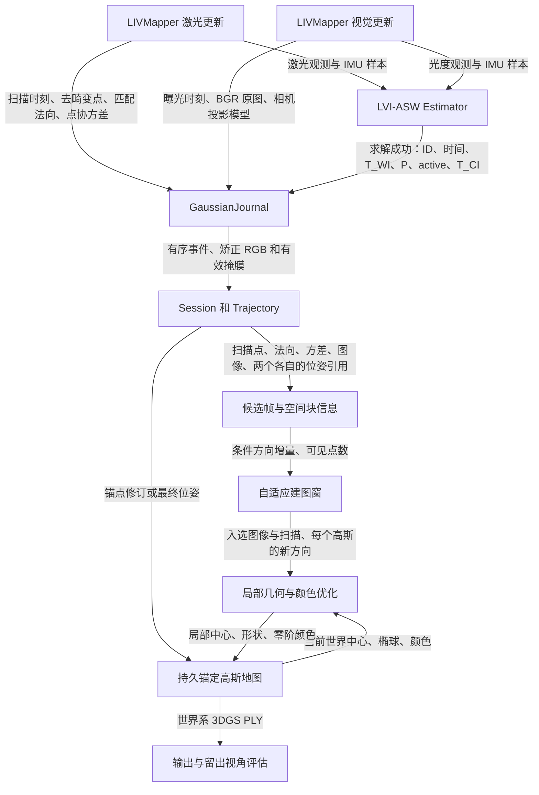

# 从 LVI-ASW 位姿滑窗到自适应高斯建图窗

本分支用上传的 **FAST-LIVO2-sliding-window.zip** 作为状态估计基线（SHA-256：`0d79bb109aaaa294a96fa46b9dfa402691f6391ca1354c0c9539c2b82932d8f2`）。第一笔提交导入源码、标定配置、启动文件和测试；不上传压缩包、原始轨迹、运行日志和论文。第二笔提交新增下述算法。仓库原有体素地图仍供 LVI-ASW 关联；3D 高斯是面向可渲染重建的另一种地图输出。

**两个窗口各管一个估计问题。** LVI-ASW 决定哪些惯导状态共同求解，为地图提供运动轨迹。建图窗只读这条轨迹，在给定计算预算下决定“哪些视角、哪些局部高斯值得更新”；不会用渲染误差另求一条轨迹。建图帧不必是惯导状态，激光扫描也不必与图像同时到达。适用对象是具有标定、能得到局部平面匹配的静态场景。

## 1. 数据从哪里来，最后去了哪里



| 阶段和入口 | 接收的数据 | 交给下一步的数据 |
|---|---|---|
| `FastLivoBridge::ProcessLidar / ProcessVision` → `GaussianJournal::scan / image` | 前者拿 `ptpl_list_`，后者拿 `img_rgb` 和标定相机。记录在状态关键帧筛选**之前**，因此普通图像也能参加建图。 | `scan(t,rows)`：每行 `[p_I(3),n_I(3),var_n]`。平面法向用当前匹配时的旋转表达回扫描局部系；点不使用临时位姿生成最终世界坐标。每扫描最多取 2048 个匹配点。`image(t,file,mask,K)`：半分辨率矫正图及有效区。 |
| `Estimator::optimization` → `GaussianJournal::solution` | Ceres 接受的完整滑窗，在删除节点前取状态；求解或边缘化失败不发布为成功。 | `solve(T_CI,poses[])`；每项为 `id,t,T,P,active`。新近移出的节点也含最终值。重置单独产生 `reset(epoch)`，不混合不同坐标段。 |
| `Session.drain` → `Trajectory.ref / at` | 分别为曝光和扫描寻找相邻的已优化状态，平移线性插值、旋转按最短旋转插值。等待最近扫描搜索区间结束，再选可用扫描。 | `Frame(t,ref,scan_id,scan_ref,rows,image,mask,K)`。超过 `pair_dt`、状态跨度大于 `max_gap` 或需外推时丢弃，并计数。 |
| `Mapper.prepare` → `policy.select` | 投影、无效像素掩膜、像素内的最近回波、纹理、相对位姿不确定性。 | `hits` 和每个三维空间块的视觉／几何方向矩阵；贪心选出受帧数与关联预算约束的建图窗。 |
| `Mapper.cycle / fit_shape` ↔ `render` | 将选中回波与邻域高斯关联，将包括未优化高斯在内的所有可见高斯参与遮挡和渲染。 | 回写锚点局部系的高斯均值、满足条件的椭球、RGB 和已见方向；生成 `window_*.jsonl`。 |
| `Session.flush / write_ply` | 最终锚点、局部高斯、未参与建图的图像。 | 每个坐标段一个 `gaussians_*.ply`；`summary.json` 含覆盖率、覆盖区 PSNR、丢帧原因。 |

## 2. 从观测到地图的五步

**① 分清“高斯的形状”和“位置估计的不确定性”。** $T_{AB}$ 将 B 系的点变换到 A 系。高斯在扫描锚点 A 内保存均值 $\mu^A$、表面法向、形状矩阵 $S^A$ 和颜色。$S^A$ 决定渲染足迹，不是位姿估计协方差。每次显示或渲染都计算

$$\mu^W=R_{WA}\mu^A+t_{WA},\qquad S^W=R_{WA}S^A R_{WA}^{T}.$$

锚点可引用一个状态，或引用两个状态和一个插值比例。状态修订后重新计算世界高斯，不向历史点反复累乘修正量。状态移出时保留其最后位姿；双端插值锚点在两个端点都退休后固定。分段重置前导出旧地图。

**② 衡量一个视角能否可靠地观察一个表面。** Ceres 输出联合加权问题的 6×6 切空间边际块，顺序 $[\delta p_W,\delta\theta_I]$，单位 m、rad。取不到时输出 `P:null`，读取端用可配置的位置、角度标准差替代；绝不将缺失当作零。对扫描时刻 A 与相机时刻 B 的同一个世界点，先对共享状态的两项雅可比作差，再传播：

$$P_{\rm rel}\simeq\sum_k (J_{Ak}-J_{Bk})P_k(J_{Ak}-J_{Bk})^\top,\quad
q_V=\left[1+\frac{\operatorname{tr}(J_\pi R_{CW}P_{\rm rel} R_{CW}^\top J_\pi^\top)}{2\sigma_{\rm px}^{2}}\right]^{-1}.$$

插值时角扰动采用端点加权的一阶近似，不存跨状态协方差；完全相同的位姿引用会抵消。这里的可靠度是调度和加权量，不应解释为已标定的独立观测概率。地图使用的点／图像也参与了轨迹估计。

**③ 决定建图窗的帧数与成员。** 在最近 `history` 秒的有限候选池内，对每个空间块求平均方向贡献。视觉用 $q_V(0.05+\tau)(I-dd^\top)$，$d$ 为视线，$\tau$ 为局部颜色梯度得分；激光用 $\sigma_0^2/(\sigma_0^2+v_n)\,nn^\top$，$n$ 是表面法向，$v_n$ 是匹配回波的法向测量方差。每轮从单位正定先验开始，按下面的量除以候选关联数排序：

$$\Delta_f=\sum_b\big[\log\det(H_b+D_{fb})-\log\det H_b\big].$$

选入后更新 $H_b$；同一扫描在同一空间块的激光贡献不重复累加。平均增益低于门槛、候选耗尽或达到工作量／帧数上限即停止，所以有效窗长可变。这个 3×3 描述量描述局部测量方向的互补性，不是完整 3DGS 参数的 Fisher 信息矩阵。

**④ 决定哪些高斯需要更新。** 有几何支撑的新表面用扫描点初始化。邻近且法向兼容的回波关联到已有高斯；同一出生回波拥有稳定标识。每个高斯在锚点坐标系保存有限角度格的历史描述量，按新观察方向的条件 logdet 增量，加上对颜色差、点面偏差的估计来排序。信息已饱和且残差很小的高斯可以继续遮挡／渲染而不占优化名额。每次最多更新 `max_active` 个；全图达到 `max_map` 后保留既有高斯并停止新增，不宣称无限规模的稠密地图。

**⑤ 更新几何和外观。** 对选择的高斯，先对局部中心做带种子位置先验的稳健点面最小二乘。对回波 $p_s^W$：

$$r_g=n_s^\top(\mu^W-p_s^W),\quad \sigma_g^2=\sigma_0^2+v_{n,s}+n_s^\top P_{\rm rel}n_s.$$

几何项在本次目标中按“扫描、回波行、高斯”去重；重线性化不是再次累加后验信息。已有至少三个非共线回波、跨至少两组扫描状态引用时，用加权样本散布和形状先验估计局部椭球并限制主轴尺度。颜色由深度排序的前向透明度合成预测：

$$\hat I(u)=\sum_j c_j a_j(u)\prod_{k<j}(1-a_k(u)).$$

用覆盖区、矫正图掩膜和图像可靠度对 Huber 光度项做颜色更新。此版本学习均值、受约束的空间形状和零阶颜色；不透明度固定，不训练高阶球谐，不用渲染修改位姿。没有 LiDAR 局部表面支撑的区域可能留下孔洞。

## 3. 先在没有 ROS 的机器上验证

在仓库根目录运行；示例路径必须尚不存在，以免覆盖上次结果。

```bash
python3 -m pip install -r gs_mapping/requirements.txt
python3 -m unittest discover -s test -p 'test_gaussian_mapping.py' -v
python3 -m gs_mapping.demo /tmp/gs_example_01
python3 -m gs_mapping /tmp/gs_example_01 --config config/gaussian_window.json --holdout-stride 3 --out /tmp/gs_adaptive_01
python3 -m gs_mapping /tmp/gs_example_01 --config config/gaussian_window.json --holdout-stride 3 --fixed --out /tmp/gs_fixed_01
```

示例用 9 次激光、8 张异步图像；每隔 3 张留出 1 张，应该有 6 张进入候选、2 张用于评估，`gaussians_000.ply` 非空。CPU 参考实现不依赖显卡。图像由已知合成场景生成，仅验证实现行为。带 Eigen3、Ceres、CMake 的环境运行 `sh scripts/check_gaussian_window.sh` 可同时执行独立 C++ 测试，其中包括已知高斯先验的位姿边际协方差检查。

实际验证记录：[Ubuntu 22.04 / Ceres 2.0 的构建与测试](https://github.com/xiaofafafafa/FAST-LIVO2/actions/runs/45193203110) 通过了 8 个 Python CPU 检查和独立 Ceres 测试程序。用上述合成回放导出过 24 个高斯；一组自适应运行的实际窗长为 1、2、3、4、4、4。没有使用真实 rosbag，也没有在该运行机上测试 CUDA。同步录制和真实 GPU 吞吐须另测。

## 4. 用自己的 rosbag 和 GS-LIVO 光栅器

1. 按原项目配置好 ROS1/catkin、驱动、vikit、OpenCV、Eigen、Ceres 并重新构建（新增 `gaussian_journal.cpp`）。选择与传感器匹配的原有标定。新 launch 支持 `profile:=avia` 和 `profile:=ntu`，故意启用上传版中的状态／活动地图修正。其它装置请在自己的 launch 设置同名参数，不能套用示例外参。
2. 工作站上使用与 NVCC 匹配的 CUDA PyTorch、主机 C++ 编译器和 Ninja。下列脚本把官方 GS-LIVO 固定到 [cc65db2](https://github.com/HKUST-Aerial-Robotics/GS-LIVO/tree/cc65db279bf0d7c4df12d21710cc4053753dd133)。放在 **catkin 目录之外**，并阅读上游 [GS-LIVO 项目及引用要求](https://github.com/HKUST-Aerial-Robotics/GS-LIVO) 和光栅器源码许可。只从上游编译 `src/lib3dgs/src/rasterize_points.cu` 与 `cuda_rasterizer` 原始前后向核，不需要修改作者的绝对路径或手工复制 .so。此集成复用其 3DGS 渲染，而非启动第二套里程计。

```bash
mkdir -p "$HOME/gs_deps" "$HOME/gs_runs"
sh scripts/fetch_gs_livo.sh "$HOME/gs_deps/GS-LIVO"
export GS_LIVO_ROOT="$HOME/gs_deps/GS-LIVO"
GS_TEST_CUDA=1 python3 -m unittest discover -s test -p 'test_gaussian_mapping.py' -v
roslaunch fast_livo mapping_gaussian_adaptive.launch profile:=ntu journal_dir:="$HOME/gs_runs/eee01_capture"
```

3. 在另一终端正常播放对应 rosbag；可在 **events.jsonl 已出现后** 开第三终端，从本仓库根目录运行下面一行。也可先录完并正常关闭 ROS 节点，移除 `--follow` 再离线重放。不要复用已存在的 capture 或 output 目录。CUDA 是显式选项：编译／设备错误不会悄悄切回 CPU。

```bash
export GS_LIVO_ROOT="$HOME/gs_deps/GS-LIVO"
python3 -m gs_mapping "$HOME/gs_runs/eee01_capture" --backend cuda --follow --config config/gaussian_window.json --out "$HOME/gs_runs/eee01_gs"
```

4. `window_000.jsonl` 给出每轮入选时间戳、候选数、活跃数、新增数、几何项数、关联工作量、运行时间。PLY 同时含 RGB 和标准零阶 3DGS 字段（log 尺度、wxyz 四元数、logit 不透明度）；可作点云查看或以 SH degree 0 加载。录制器为保持顺序，同步写入 PNG 和事件；优化在单独进程。Ceres 边际协方差计算、录制 I/O、GPU 首次编译都应与地图迭代耗时分别统计。`budget_ms` 在完整迭代之间生效，不是硬实时保证。若 `missing_cov_blocks` 常增，应排查秩、数据与先验；可显式设置 `marginal_covariance:=false` 测试回退代价。`no_supported_scan`／`no_image_pose` 频繁出现时，先检查图像、点面关联、时钟与外参，不要先增大容差。

## 5. 作为第二项博士工作的实验入口

| 待验证的问题 | 在同一份 capture 上怎么跑 | 应报告什么 |
|---|---|---|
| 自适应建图窗是否比固定窗有效？ | 完整方法 vs `fixed_frames:true`；只替换为最近帧优先，固定其它设置。另可用 `--fixed` 得到帧与高斯两个策略都固定的对照。 | 留出视图 PSNR **和覆盖率**、窗口时间跨度、帧数分布、每轮耗时 p50/p95。 |
| 是否值得分配不同的高斯更新预算？ | `fixed_splats:true` 关闭方向增益的选择；扫 `max_active/max_work`，保持相同硬上限、后端和留出视角。 | 质量–耗时曲线、活跃／全图数量、地图大小、峰值显存；显存需在 GPU 工作站采集。 |
| 位姿可信度和形状估计各贡献多少？ | 分别令 `use_pose_uncertainty:false`、`learn_shape:false`；其它配置不动。分开统计纹理弱、平面退化与正常片段。 | 图像覆盖区误差；用独立激光测量统计点面或深度误差，不能用已参与优化的点充当几何真值。 |
| 与原版 GS-LIVO 相比怎样？ | 同一设备、序列、分辨率、标定、输出时间和留出集合；报告各自原生位姿。若要隔离地图表示，再单做相同轨迹的建图对比。 | 分开报告 ATE/RPE、建图质量和资源开销。同一份 LVI-ASW 轨迹只改变建图策略时，不能据此声称轨迹精度提高。 |

`--holdout-stride` 保证留出图像不参加高斯初始化、选帧或颜色更新。它们可能已经用于 **LVI-ASW** 位姿估计，所以该结果是“给定轨迹的地图评估”，不是完全未见的定位测试。内置脚本报告的是有效覆盖像素上的 PSNR，同时给出覆盖率；这与对全画面计分的公开 PSNR 不可直接混用。前述实验均应以真实测量完成后再写入论文。
